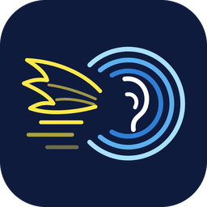

# SkyEar

**A free, open-source Android app for learning what drones and aircraft sound like, and for building a library of labeled recordings.**

SkyEar started as a drone-safety idea: help people recognize the sound of different drones and tell them apart from the many things that sound similar (leaf blowers, mopeds, insects, small planes). It is not for sale and never will be.

> **Status: experimental (version 0.2).** Field-tested on a single Android phone. It is a learning and research tool, **not** a drone detector or a safety system. Do not use it for navigation or anything safety-critical.

## What it does

| Tab | What you can do |
|---|---|
| **Field** | One **Start scan** button listens through the microphone, checks public ADS-B data for nearby aircraft every 15 seconds, and scans for drones broadcasting Remote ID. A **radar** shows nearby aircraft and the direction your phone is pointing. You can also record labeled clips tagged with the aircraft and phone direction. |
| **Settings** | Units, theme, text size, scan interval, beam width, weather on or off, and more. |
| **Synth** | Build drone and lookalike sounds from adjustable parameters (blades, motors, RPM, load, distance, fly-by). 15 drone presets and 10 non-drone lookalikes. |
| **Quiz** | Hidden sounds, scored on drone vs. not-a-drone, with hits, false alarms and d-prime. |
| **Listen** | Analyze the microphone or a saved recording: spectrogram, pitch, harmonics, closest presets. |
| **Library** | Your clips with analysis, likely source aircraft, pointing data, labels and notes. Export to Downloads. |

## What it cannot tell you

- **An empty radar is not an empty sky.** Aircraft appear only if they send ADS-B and a volunteer receiver near you reports them to adsb.lol. Aircraft without a transponder, some military flights and anything outside receiver coverage are missing.
- **Silence on the drone scan is not proof there is no drone.** Only drones that broadcast Remote ID show up, within a few hundred meters. Many drones do not broadcast it, and SkyEar cannot detect those.
- **Sound matches are estimates.** Drone sounds are generated from adjustable settings, not played from recordings, and have not yet been compared with real drones.
- **It is not a safety system.** If you feel unsafe, contact local authorities or emergency services.

The same points are in the app's first-run guide and Settings page.

## Try it

1. On your Android phone, download the APK from the **[latest release](https://github.com/floydswoop/sky-ear/releases)** (SkyEar v0.2).
2. Open it and allow installs from this source when Android asks. (It is an unsigned debug build for testing.)
3. Allow microphone, location and nearby devices on first use. Headphones help, since phone speakers cannot reproduce low tones.

Requires Android 8 or newer (Remote ID over Wi-Fi needs Android 11 or newer).

## Build it yourself

You need a computer with the free [Android Studio](https://developer.android.com/studio). The step-by-step guide for beginners is **[docs/BUILDING.md](docs/BUILDING.md)**.

The whole interface is one file, [`app/src/main/assets/index.html`](app/src/main/assets/index.html), so you can change colors, text and layout without touching Kotlin.

## Learn more

- [Full project README](docs/PROJECT.md): permissions, tests, known limitations, credits
- [How it works](docs/HOW_IT_WORKS.md): sound analysis, ADS-B matching, Remote ID, phone pointing
- [Privacy](docs/PRIVACY.md): what stays on the phone and what is sent out (your approximate location goes to the ADS-B service, api.adsb.lol, and, rounded to about 1 km, to the weather service, open-meteo.com)
- [The math](docs/MATH.md): the equations the app uses, in shorthand
- [Contributing](CONTRIBUTING.md): how to help and run the tests (`node tests/run-tests.js`)

## Notices

Aircraft data comes from the community [adsb.lol](https://adsb.lol) API and weather from [Open-Meteo](https://open-meteo.com) (free for non-commercial use), and their terms may change. Drone brand names are trademarks of their owners, used only to describe approximate sound, with no affiliation or endorsement. Recording sound can capture people's voices, so follow the recording laws where you are.

## License

[MIT](LICENSE)
